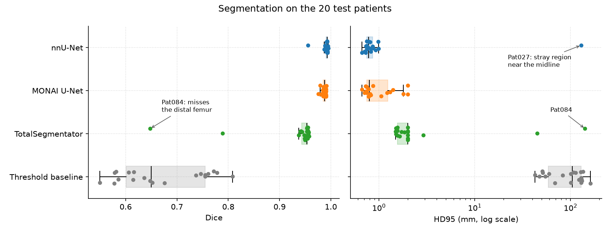
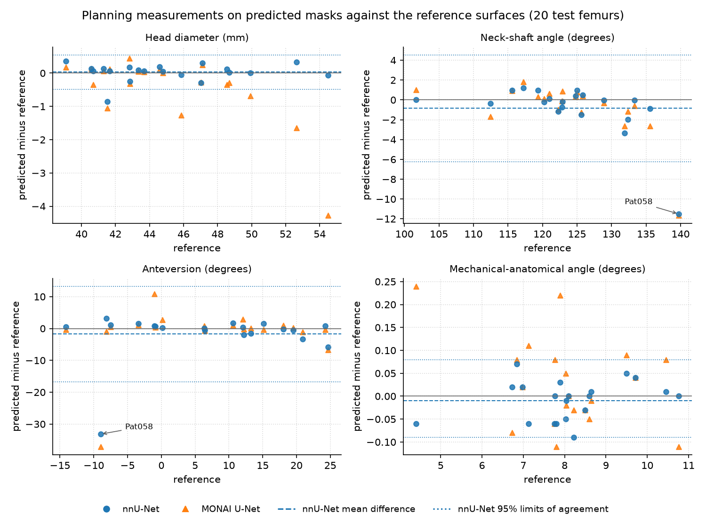
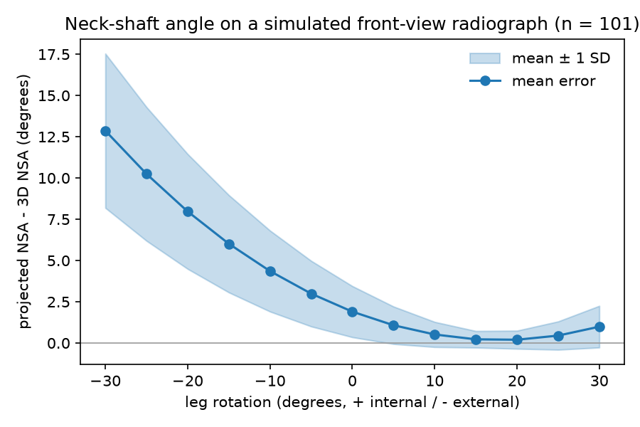
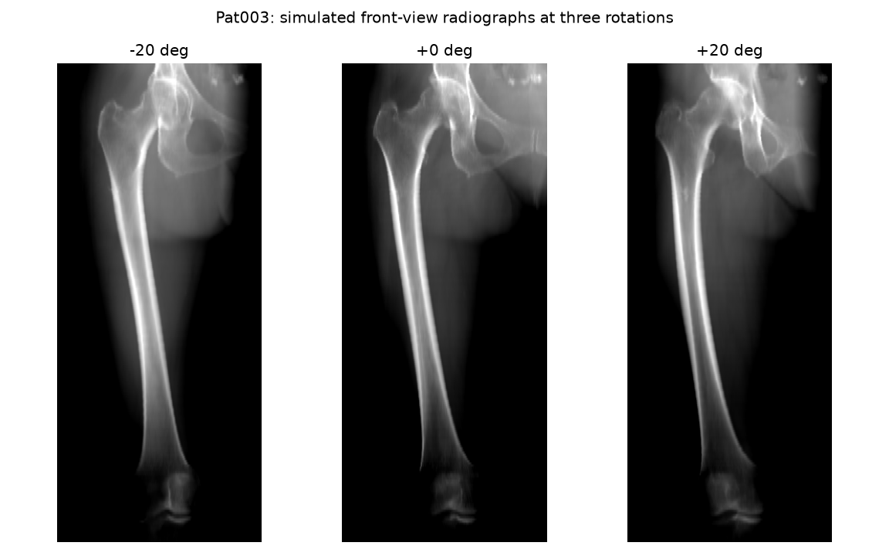

# lower-limb-femur-study

Femur segmentation and planning measurements on 101 public CT scans (HFValid v3), with two follow-up experiments: how leg rotation distorts the neck-shaft angle on a front-view radiograph, and how well femurs from different patients can be registered.

Questions:

1. How do a threshold baseline, a MONAI 3D U-Net, nnU-Net v2 and TotalSegmentator compare on the same held-out patients?
2. Do planning measurements taken on predicted masks agree with the same measurements on the reference surfaces?
3. How large is the neck-shaft angle error on a simulated radiograph when the leg is rotated?
4. What landmark error remains after rigid, affine and surface registration between patients?

Design choices, problems met along the way and what they taught me: [docs/NOTES.md](docs/NOTES.md).

## Data

101 femur CTs from older women, each with a reference surface (STL) and four landmarks.
Three scanner models, slice thickness 2.5 to 5 mm reconstructed at a 1 to 2 mm step.
Details and quality checks: [docs/DATA_CARD.md](docs/DATA_CARD.md).

Reference masks are the STL surfaces voxelised on each CT grid.
Patient-level split: 71 train, 10 validation, 20 test.
Everything was tuned on validation; the test set was scored once.

## Results

### 1. Segmentation (test, 20 patients)



| Method | Dice | HD95 (mm) | ASD (mm) |
|---|---|---|---|
| Threshold baseline (200 to 2000 HU, largest component, hole filling) | 0.672 ± 0.084 | 97.2 ± 36.8 | 27.1 ± 16.1 |
| TotalSegmentator `total`, 1.5 mm model, no training | 0.927 ± 0.075 | 11.0 ± 32.2 (median 2.0) | 2.37 ± 6.30 (median 0.71) |
| MONAI 3D U-Net (residual units), 1.5 mm, 1000 epochs | 0.987 ± 0.004 | 1.03 ± 0.44 (median 0.79) | 0.24 ± 0.13 (median 0.19) |
| nnU-Net v2 `3d_fullres`, 100 epochs | 0.990 ± 0.008 | 7.2 ± 28.6 (median 0.78) | 0.71 ± 2.44 (median 0.13) |

Mean ± SD over patients; bootstrap 95% intervals, paired tests and per-patient scores are in `results/segmentation/`.
Training on one RTX 3060 Laptop GPU (6 GB): MONAI 73 minutes, nnU-Net about 2.6 hours with its patch reduced to 96 x 128 x 96 to fit in memory.

- nnU-Net beats TotalSegmentator on all three metrics (paired Wilcoxon, p < 0.002).
- nnU-Net has a higher Dice than the MONAI U-Net (median difference 0.004, p = 0.002), but their HD95 does not differ (p = 0.24). The MONAI U-Net has no failure case: its lowest Dice is 0.975 and its highest HD95 is 2.0 mm.
- nnU-Net's mean HD95 comes from one patient (Pat027): a separate 22 ml region near the midline. Keeping only the largest connected component gives Dice 0.986 and HD95 1.4 mm for that patient. No validation case needed this step, so the table reports the raw output.
- TotalSegmentator fails on two patients (Dice 0.65 and 0.79) by stopping short of the knee: in Pat084 it misses the distal 40% of the femur's length.
- The threshold baseline cannot separate the femur from the pelvis at the hip or from the tibia at the knee, which gives the large surface distances.

### 2. Planning measurements

Measured on the reference surfaces of all 101 femurs (`src/planning.py`):

| Measurement | Method | Mean ± SD (range) |
|---|---|---|
| Head diameter | Trimmed least-squares sphere fit | 44.6 ± 3.1 mm (38.6 to 54.5) |
| Head centre vs dataset landmark | Distance | 0.60 ± 0.30 mm (max 1.9) |
| Neck-shaft angle | Head centre to the narrowest neck section, against the shaft axis | 124.3 ± 7.8 degrees (101.7 to 148.4) |
| Anteversion | Neck axis against the posterior condylar axis, in the plane perpendicular to the mechanical axis | 7.1 ± 11.7 degrees (-21.6 to 26.8) |
| Mechanical-anatomical angle | Head-to-knee line against the mid-shaft axis | 8.0 ± 1.2 degrees |

Agreement on the 20 test patients, measured on a mesh built from each predicted mask (marching cubes, then Taubin smoothing) against the reference surface:

| Source of the mesh | Head diameter | Neck-shaft angle | Anteversion | AMA |
|---|---|---|---|---|
| Reference mask (control) | 0.09 mm | 0.53 (median 0.37) | 0.97 (median 0.49) | 0.03 |
| nnU-Net | 0.18 mm | 1.36 (median 0.80) | 2.99 (median 0.98) | 0.03 |
| MONAI U-Net | 0.59 mm | 1.51 (median 0.90) | 3.48 (median 0.88) | 0.08 |
| TotalSegmentator | 0.66 mm | 1.12 (median 0.65) | 2.59 (median 1.78), 18 of 20 | 0.13 |
| Threshold baseline | 7.74 mm | 12 of 20 measured, median 22 | 12 of 20 measured, median 30 | 3.45 |

Mean absolute difference, angles in degrees; Bland-Altman bias and limits are in `results/planning/agreement_test.csv`.
The control row is the error added by going through a voxel mask at all.
The threshold masks include parts of the pelvis, which pulls the head fit off the femur.



The largest differences for all three models come from one femur (Pat058).
Its nnU-Net mask has Dice 0.99 and HD95 0.8 mm, yet the neck-shaft angle moves by 11.5 degrees and anteversion by 33 degrees: the narrowest-section search settles on a different neck section after a small surface change.
High overlap scores therefore do not guarantee a stable angle, and the neck-axis method needs a stability check before clinical use.

### 3. Neck-shaft angle on a simulated radiograph

Each femur's 3D neck and shaft axes are placed in a femoral frame (mechanical axis and posterior condylar axis), rotated about the mechanical axis, and projected onto a front-view detector plane (`src/xray_projection.py`).



| Leg rotation | Projected minus 3D angle (101 femurs) |
|---|---|
| 30 degrees external | +12.9 ± 4.7 |
| 20 degrees external | +8.0 ± 3.5 |
| Neutral (knee forward) | +1.9 ± 1.6 |
| 15 to 20 degrees internal | +0.2 ± 0.5 |

With the knee facing forward the radiograph overstates the angle by about 2 degrees, and by 8 degrees at 20 degrees of external rotation.
The error is smallest at 15 to 20 degrees of internal rotation, and the rotation that minimises it rises with the femur's anteversion (r = 0.48).
This matches the clinical practice of rotating the leg internally for a hip radiograph.
The experiment projects the measured axes in parallel, so it isolates rotation and ignores beam divergence and soft-tissue overlap.



### 4. Registration between patients

Ten same-side pairs (validation to test), scored by the mean distance between the transformed head, greater trochanter and knee landmarks (`src/registration.py`):

| Method | Landmark error, mean ± SD (mm) | Median |
|---|---|---|
| None | 87.2 ± 68.5 | 55.6 |
| Centre-of-mass alignment of the masks | 25.5 ± 7.3 | 24.2 |
| Rigid, CT, Mattes mutual information | 17.2 ± 12.4 | 13.5 |
| Rigid, smoothed masks, mean squares | 15.7 ± 9.4 | 14.6 |
| Affine, smoothed masks | 14.7 ± 10.7 | 14.3 |
| Rigid ICP on surfaces (VTK) | 14.1 ± 8.0 | 13.9 |

Different femurs differ in length and shape, so part of the remaining 14 mm is real anatomy, not registration error.
As a check of the registration code, each of 10 CTs was moved by a known rigid transform (rotations of 4 to 8 degrees, a 21 mm shift) and registered back: landmark error fell from 34.8 mm to 0.03 mm (max 0.05).

## Running it

```bash
pip install -e ".[dev]"                 # analysis and tests
pip install -e ".[models,dev]"          # adds torch, MONAI, nnU-Net, TotalSegmentator
pytest                                  # unit tests on synthetic data, no dataset needed
docker build -t femur-study . && docker run --rm femur-study   # the same tests in a container
python src/plot_results.py              # redraw the summary figures from results/
```

The full pipeline, from download to figures: [docs/SETUP.md](docs/SETUP.md).

## Repository

```
src/
  config.py              paths (set FEMUR_DATA) and output folders
  audit.py               header audit of all scans
  voxelize.py            STL to mask on the CT grid
  split_data.py          patient-level split
  data_quality.py        checks before training
  convert_nnunet.py      nnU-Net raw dataset
  classical_baseline.py  threshold baseline
  monai_pipeline.py      MONAI 3D U-Net: train, predict
  totalseg_pipeline.py   TotalSegmentator femur masks
  metrics.py             Dice, HD95, ASD in mm
  evaluate.py            scoring, bootstrap intervals, paired tests
  geometry.py            sphere and line fits
  planning.py            planning measurements
  planning_agreement.py  predicted against reference measurements
  xray_projection.py     rotation experiment and simulated radiograph
  registration.py        SimpleITK and VTK registration with landmark error
  plot_results.py        summary figures
tests/                   unit tests on synthetic data
results/
  data/                  header audit and quality checks
  segmentation/          per-patient scores, summaries and paired tests
  planning/              measurements per method and agreement
  projection/            rotation experiment
  registration/          between-patient and known-transform results
  training/              MONAI training log
figures/
docs/                    notes, data card, setup
splits.json              patient-level split
```

## Limitations

- One dataset from one centre, older women only, no external test set.
- Reference surfaces come from a single expert segmentation; there is no second reader to give an inter-observer range.
- Planning angles depend on the axis definitions used here and were not compared with clinicians' measurements.
- The radiograph experiment projects axes, not images, and models rotation only.
- 20 test patients give wide intervals for anything but the large differences.

## Data and licence

HFValid v3: [10.6092/unibo/amsacta/8431](https://doi.org/10.6092/unibo/amsacta/8431), CC BY 4.0.
No images, masks or meshes are included here.
Code: MIT.
